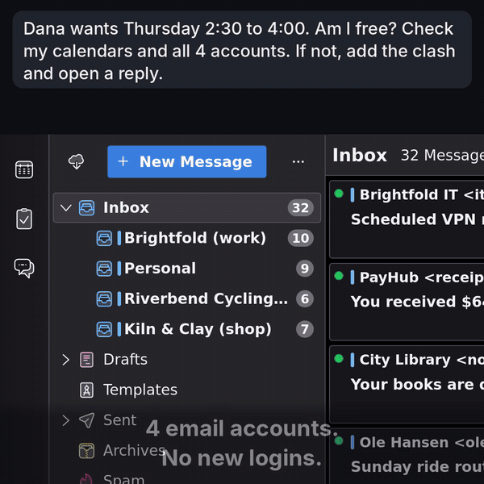

# Commonpost MCP for Thunderbird

[](https://github.com/commonpost/thunderbird-mcp/actions/workflows/ci.yml)
[](https://www.bestpractices.dev/projects/14985)
[](#what-you-can-do)
[](#security)
[](https://www.thunderbird.net/)
[](#quick-install-about-3-minutes)
[](LICENSE)

MCP server for Thunderbird: mail, calendar, contacts in all your accounts. Windows, macOS, Linux.

Your AI assistant can search, read and draft mail in every account you have in Thunderbird, and check it against your calendar and contacts. Free and open source (MIT), through the [Model Context Protocol](https://modelcontextprotocol.io/).

Latest release: **v0.25.0** (2026-11-12) -- see the [changelog](CHANGELOG.md) or [all releases](https://github.com/commonpost/thunderbird-mcp/releases).

<p align="center">
  
</p>
<p align="center"><a href="docs/demo.mp4">Full video (25 s)</a>: a real run on a demo mailbox with invented data.</p>

- **Every account you already have in Thunderbird.** Gmail, Outlook.com, Microsoft 365, your own domain, IMAP, POP:
  no new login, no password to hand over.
- **Mail, calendar and contacts together.** Your assistant can check an email against your calendar.
- **Nothing is sent without your click.** New mail and replies open in Thunderbird's compose window, for you to read
  and send. Calendar events are added directly by default, and no invitation is sent.
- **Email is treated as untrusted.** Text a sender hides from you is removed before your assistant reads it. That
  reduces prompt injection; it does not prevent it, which is why sending needs your click ([details](#protections)).
- **Runs on your computer.** What the assistant reads goes to the AI service you use, not to us. Each release can be
  rebuilt byte for byte from this source.

**Try asking:**

```text
Am I free Thursday at 2:30? Check my calendars and all my email accounts.
Find the invoice for my dishwasher, whatever account it went to, and open a warranty claim with it attached.
What needs a reply before Friday? Open each reply for me to review.
```

---

## Contents

- [Quick install (about 3 minutes)](#quick-install-about-3-minutes)
- [Why?](#why)
- [How it works](#how-it-works)
- [What you can do](#what-you-can-do)
- [Setup](#setup)
- [Security](#security)
  - [Why Thunderbird says "full, unrestricted access"](#why-thunderbird-says-full-unrestricted-access)
- [If Thunderbird disables Experiment add-ons on the Release channel](#if-thunderbird-disables-experiment-add-ons-on-the-release-channel)
- [Troubleshooting](#troubleshooting)
- [Development](#development)
- [Project structure](#project-structure)
- [Known issues](#known-issues)
- [License and credits](#license-and-credits)

## Quick install (about 3 minutes)

Requirements: Thunderbird 140 or later on Windows, macOS or Linux. Node.js 22 or later, except with the Claude
Desktop bundle.

Every tool works the same on the three systems. One difference: on Windows, attachments go through the bridge rather
than by file path (see [attachments on Windows](#attachments-refused)).

> **For AI agents installing this:** step 1 happens in Thunderbird's window, so ask the user to do it, then continue.
> This project is not published on npm, PyPI or Docker Hub: do not use `npx` or `uvx`. Its only sources are this
> repository's [releases](https://github.com/commonpost/thunderbird-mcp/releases/latest), the Claude Code plugin and
> the Gemini CLI extension. `scripts/install.sh` is for development only. For Claude Desktop, the `.mcpb` bundle is
> the whole install: no Node.js and no config file to edit. The bridge and the add-on do not need the same version
> number. Step by step: [llms-install.md](llms-install.md).

**1. Install the add-on in Thunderbird.**

- Download the file ending in `.xpi` from the [latest release](https://github.com/commonpost/thunderbird-mcp/releases/latest).
- In Thunderbird: menu ≡ (top right) > Add-ons and Themes > gear icon > Install Add-on From File, then restart
  Thunderbird.
- Thunderbird warns that the add-on gets "full, unrestricted access": it says so for every add-on of this kind
  ([why, and what this one does](#why-thunderbird-says-full-unrestricted-access)).

**2. Connect your assistant.** Pick the line for the one you use.

- **Claude Desktop** (Windows, macOS): download the file ending in `.mcpb` from the same release and open it with
  Claude Desktop, or use Settings > Extensions > Advanced settings > Install Extension. Nothing else to install: it
  uses the Node.js that Claude Desktop ships with. Its name can carry a lower number than the add-on (for example
  `v0.20.0` beside a `v0.22.4` add-on): it is named after the bridge it holds, which changes less often. See
  [Claude Desktop](#claude-desktop-one-click-bundle).
- **Claude Code**, with the plugin, which keeps the bridge up to date (see [Claude Code plugin](#claude-code-plugin)):

  ```
  claude plugin marketplace add commonpost/thunderbird-mcp
  claude plugin install commonpost-mcp@commonpost
  ```

- **Gemini CLI**, as an extension that carries the bridge:

  ```
  gemini extensions install https://github.com/commonpost/thunderbird-mcp
  ```

- **Any other client** (VS Code, Cursor, Codex CLI, Claude Code without the plugin...):
  1. Check Node.js: `node --version` must show 22 or later.
  2. Download the bridge, a single file, into a folder you will keep. macOS and Linux:

     ```
     mkdir -p ~/commonpost-mcp && curl -fL -o ~/commonpost-mcp/mcp-bridge.cjs https://github.com/commonpost/thunderbird-mcp/releases/latest/download/mcp-bridge.cjs
     ```

     Windows (PowerShell):

     ```
     New-Item -ItemType Directory -Force "$env:USERPROFILE\commonpost-mcp" | Out-Null; Invoke-WebRequest -OutFile "$env:USERPROFILE\commonpost-mcp\mcp-bridge.cjs" https://github.com/commonpost/thunderbird-mcp/releases/latest/download/mcp-bridge.cjs
     ```

  3. Register it. Claude Code, on Linux and on Windows (`-s user` makes it available in every folder):

     ```
     claude mcp add -s user thunderbird -- node "/home/<you>/commonpost-mcp/mcp-bridge.cjs"
     claude mcp add -s user thunderbird -- node "C:\Users\<you>\commonpost-mcp\mcp-bridge.cjs"
     ```

     Other clients: add this to the client's MCP config, with the full path of the file (each client has its own file
     and format: see [Other MCP clients](#other-mcp-clients)). In JSON, write Windows paths with `/`
     (`"C:/Users/<you>/commonpost-mcp/mcp-bridge.cjs"`); a JSON file does not expand `~`. On macOS, if the client
     cannot find `node`, set `command` to the full path that `which node` prints.

     ```json
     {
       "mcpServers": {
         "thunderbird": {
           "command": "node",
           "args": ["/home/<you>/commonpost-mcp/mcp-bridge.cjs"]
         }
       }
     }
     ```

**3. Test it.** With Thunderbird open, ask your assistant: "list my Thunderbird accounts". It should name your
accounts; your client may first ask you to allow the tool. Nothing comes back? Check that Thunderbird is open and the
add-on enabled, then quit your client completely and start it again (Claude Desktop on Windows: its icon near the
clock > Quit). Still nothing: see [Troubleshooting](#troubleshooting).

**4. Choose what your assistant may see.** Open the add-on's options (menu ≡ > Add-ons and Themes > Commonpost MCP for
Thunderbird > wrench button) and pick the accounts and tools. Until you do, every account and tool is visible to MCP
clients.

To update or remove it later, see [Updating](#updating) and [Uninstall](#uninstall).

Snap, Flatpak and macOS need no extra step in most cases; see [Sandbox-aware connection discovery](#sandbox-aware-connection-discovery). If something fails, see [Troubleshooting](#troubleshooting).

---

## Why?

Thunderbird has no official API for AI tools. Your AI assistant can't read your email, can't help you draft replies, can't organize your inbox. This extension fixes that -- it exposes 42 tools over MCP so any compatible AI (Claude, GPT, local models) can work with your mail the way you'd expect. The list is kept short so that assistants choose among them reliably; older Cursor versions also sent an agent only the first 40 tools of all servers combined (since January 2026 Cursor loads tool descriptions only when needed), and VS Code allows 128 tools per request.

Mail sends require review by default because **Block `skipReview`** for mail starts enabled: `skipReview: true` is honored only after you explicitly disable it. **By default, nothing is sent without your review.** Events and tasks are added at once on a new install, as `updateEvent` and `deleteEvent` change them: they send no invitation, and asking for six appointments means nothing to save by hand. Enable **Block `skipReview`** for events and tasks to review each one in Thunderbird's dialog.

---

## How it works

```
                    stdio              HTTP (localhost:8780-8789)
  MCP Client  <----------->  Bridge  <--------------------->  Thunderbird
  (Claude, etc.)           mcp-bridge.cjs                    Extension + HTTP Server
```

The Thunderbird extension embeds a local HTTP server with session-scoped auth tokens. The Node.js bridge translates between MCP's stdio protocol and HTTP, discovering the port and token automatically via a connection file. The bridge handles MCP lifecycle methods (initialize, ping) locally, so clients can connect even before Thunderbird is fully loaded. If the client asks for the tools while Thunderbird is not running, the bridge answers with the tools Thunderbird last listed, which it keeps in your cache folder (`%LOCALAPPDATA%\commonpost-mcp` on Windows, `~/Library/Caches/commonpost-mcp` on macOS, `$XDG_CACHE_HOME/commonpost-mcp` or `~/.cache/commonpost-mcp` elsewhere); tool calls fail until Thunderbird is started.

---

## What you can do

### Mail

| Tool | Description |
|------|-------------|
| `listAccounts` | List all email accounts and their identities |
| `listFolders` | Browse folder tree with message counts -- filter by account or subtree; `savedSearches` lists saved searches instead; `refresh` with `folderPath` first fetches that folder's new mail from its mail server (IMAP, Exchange, Graph; not news or feeds) and waits up to 20 s |
| `searchMessages` | Search headers across accounts. Words must all match (subject, from, to, cc, preview); operators `from:`, `to:`, `cc:`, `subject:`, `participant:` (from/to/cc/bcc; `@domain` matches addresses in that domain only, commas list alternatives: `participant:@acme.com,@acme-group.com`) and quoted phrases can be combined, e.g. `participant:@acme.com subject:"invoice 42"`. `groupBy: "sender" \| "thread"` returns one row per sender or conversation (`latestId` is the newest message that is not a draft); `threadOf: {messageId, folderPath}` returns a whole conversation across folders (Sent included), oldest first (it reads at most 10,000 headers, then sets `incomplete: true`). A `Re:` message sent without threading headers joins by subject the earlier message its sender took part in (`linkedBy: "subject"`); the same mail sent separately to several people and repeated notifications stay separate. Filters pick messages of the conversation without cutting its links. Trash and Junk are skipped unless `includeTrash` or an explicit `folderPath`. Always returns `{ messages, totalMatches, offset, limit, hasMore }` (default 20 rows, max 200); `format: "table"` returns `{ columns, rows }`, and `format: "legacy"` the output of 0.10 and earlier (deprecated), see CHANGELOG. Also `countOnly`, `includeSubfolders`, date range, unread/flagged filters, `tag` (name or key; an unknown one is matched as a raw keyword and `warning` lists the known tags), `searchBody` (Gloda full text: terms under 3 characters are left out and listed in `warning`, English words match other forms, Russian and other languages only the exact word form) and `dedupByMessageId` (copies in several folders collapse into one row with `dupLocations`). `attachmentName` (part of a filename, any case) and `attachmentType` (`application/pdf`, or a prefix such as `image/`) keep messages with a matching attachment, combined with the other filters; each row lists its matching attachments (`name`, `contentType`, `size`). Only messages Thunderbird marks as having attachments are read, from their local copy (nothing is downloaded or decrypted), at most 500 per call and 16 MiB each; `attachmentSearch` gives how many were checked and why the others were skipped (`encrypted`, `tooLarge`, `notOffline`, `unreadable`, `limitReached`). Thunderbird flags a message from its top-level structure, so a signed message (`multipart/signed`), a `multipart/related` one or a single-part attachment is usually not found. While reading encrypted messages is not allowed, a query with words leaves out messages with an encrypted envelope, as without attachment options. `attachmentName` and `attachmentType` cannot be combined with `searchBody`, `threadOf` or `format: "legacy"`. `fields` returns only the listed columns (`date`, `author`, `recipients`, `ccList`, `subject`, `read`, `flagged`, `tags`, `preview`, `dupLocations`); `id`, `folderPath` and the columns an option adds are always kept; not with `countOnly`, `groupBy` or `format: "legacy"`. |
| `getMessage` | Read full email content -- `bodyFormat`: `markdown` (default), `text`, or `html`. Bodies are capped (`maxBodyChars`, default 20000); a longer body sets `bodyTruncated` and `nextBodyOffset`, read the rest with `bodyOffset`. Set `rawSource: true` for the complete RFC 2822 source (same cap), decoded as UTF-8 when valid, else by its top-level, part or detected charset (`rawCharset`; a `warning` when parts declare different charsets, listed in `rawMixedCharsets`, or when invalid UTF-8 was replaced), with hidden characters removed as in a body; `rawEncoding: "base64"` returns the exact bytes. Optional attachment saving. Set `includeInlineImages: true` to append supported inline CID images as MCP image blocks (PNG, JPEG, GIF, or WebP; max 1 MiB base64 per image and 4 MiB total). Skipped images are reported in attachment metadata. `authentication` gives the SPF, DKIM and DMARC results of the topmost `Authentication-Results` header, as the receiving mail server reported them (`authservId` names it); Thunderbird checks none of this, and a sender can forge such headers lower down. |
| `getMessages` | Read full email content for up to the configured batch limit in one call (default 10, max 20). Uses the same `bodyFormat`, `rawSource`, and attachment options as `getMessage`; each item supplies `messageId` and `folderPath`. Bodies are capped per message (`maxBodyChars`, default 4000). `headersOnly` returns only the headers as received and the flags, for up to 200 messages whatever that limit, without parsing any body; a List-Unsubscribe header also comes parsed as `unsubscribe` (`mailto`, `https`, `oneClick`), for reading only. |
| `getRecentMessages` | Recent messages newest first from all folders (Trash/Junk skipped) or one folder -- `daysBack` (default 7), unread/flagged filters, `includeTrash`, pagination. Same envelope, rows and `format` as `searchMessages`. `fields` as in `searchMessages`. |
| `displayMessage` | Open a message in Thunderbird's GUI -- `3pane` (default), `tab`, or `window` mode |
| `updateMessage` | Mark read/unread, flag/unflag, add/remove tags, move between folders, or trash -- supports bulk via `messageIds`. Tags by the name shown in Thunderbird (`Important`, `To Do`) or by key (`$label1`); another keyword is added, and what cannot be a keyword is skipped, both with a `warning` listing the known tags |
| `deleteMessages` | Delete messages as Thunderbird's Delete key does: moved to Trash, except in Trash itself (deleted for good) and on IMAP accounts set not to move deleted mail (their setting applies) |
| `createFolder` | Create new subfolders to organize your mail, or a saved search (virtual folder: a live view, nothing moved) with `savedSearch` |
| `renameFolder` | Rename an existing mail folder; returns its new URI as `path` |
| `deleteFolder` | Delete a folder (moves to Trash, or permanently deletes if already in Trash); a saved search is removed as a view, no mail deleted |
| `moveFolder` | Move a folder to a new parent within the same account |
| `emptyTrash` | Permanently delete all messages in Trash (including subfolders) |
| `emptyJunk` | Permanently delete all messages in Junk/Spam (including subfolders) |

### Compose

| Tool | Description |
|------|-------------|
| `sendMail` | Compose a new email -- opens a review window; direct sending requires explicitly disabling the `skipReview` safety block, and adds the identity signature and automatic Cc/Bcc as the compose window would; `dryRun` reports what the call would do (sender, recipients, attachments, estimated size) or the error it would return, and does nothing |
| `replyToMessage` | Reply with quoted original and proper threading, from the identity Thunderbird would pick. `mode`: `window` (default) opens a review window, `draft` saves a draft with the recipients Thunderbird's Reply / Reply All computes and the body its reply window builds (cite line, quote, signature, reply position), `send` (or `skipReview: true`) sends directly -- it needs explicit `to` and `from` and is subject to the same safety block. `latestInThread: true` (window or draft only) replies to the newest message of the conversation, Sent included, and returns it as `repliedTo`; `threadIncomplete` in the result means a large mailbox was read in part and a newer message may exist |
| `forwardMessage` | Forward with all original attachments preserved, from the identity Thunderbird would pick. `mode` as for `replyToMessage` (`draft` and `send` get the subject and body Thunderbird's forward window builds: header table, original body, signature); `to` is optional except with `send`, which needs explicit `to` and `from` |
| `saveDraft` | Save a new message as a draft, as Thunderbird's compose window saves it (with the identity signature), or edit an existing draft with `draftId` -- returns its `messageId` and `folderPath` |

All compose tools open a window for you to review and edit before sending by default. The **Block `skipReview`** setting for mail is on by default, so `skipReview: true` (and `mode: "send"`) is rejected until you explicitly disable it; only then can it send directly. `mode: "draft"` only saves a draft, so the preference does not block it (even next to `skipReview: true`); it needs the `saveDraft` tool to be enabled in the settings, as a tool you disabled is not reachable through another one. Attachments can be file paths or inline base64 objects.

A direct send or saving a draft (`saveDraft`, `mode: "draft"`) can take a while: the bridge waits up to 180 s for Thunderbird (30 s for every other call). Your MCP client may also have its own time limit for a tool call; if it is shorter than 180 s, the client can give up while Thunderbird goes on sending or saving, so check the Sent folder and the Outbox (or the Drafts folder) before retrying to avoid sending the message, or saving the draft, twice.

Compose tools validate the `from` identity strictly -- if the specified sender doesn't match any configured Thunderbird identity, the tool returns an error instead of silently substituting another account.

### Filters

| Tool | Description |
|------|-------------|
| `listFilters` | List all filter rules with human-readable conditions and actions; with `confirmation: true`, read the state of a pending or recent confirmation instead, optionally one by `confirmationId` (see below). `format: "table"`: one row per rule, without its conditions |
| `createFilter` | Create filters with structured conditions (from, subject, date...) and actions (move, tag, flag...) |
| `updateFilter` | Modify a filter's name, enabled state, conditions, or actions; `filterName` refuses an index that now points at another rule |
| `deleteFilter` | Remove a filter by index; `filterName` refuses an index that now points at another rule |
| `reorderFilters` | Change filter execution priority |
| `applyFilters` | Run filters on a folder on demand -- let your AI organize your inbox |

Full control over Thunderbird's message filters. Changes persist immediately. Your AI can create sorting rules, adjust priorities, and run them on existing mail. `applyFilters` runs only the enabled rules marked "Manually Run" (tick it in the filter editor on the rules the assistant may launch) and lists the ones it skipped.

Filter rules that **forward or reply** send mail without the review window that the compose tools keep. The **Block filter forward/reply** setting (options page, Send Safety) is on by default: while it is on, such rules cannot be created or changed through MCP, and a filter list that holds one cannot be run through `applyFilters`. Deleting the rule stays possible. If you choose **Ask me each time** instead, a request of that kind returns `pending_user_confirmation` and Thunderbird shows a dialog with the rule, its conditions and its full destination; nothing is written unless you confirm it there, and closing the dialog or not answering within ten minutes writes nothing. Whatever the setting, a rule that forwards or replies cannot be created or changed through MCP to run on outgoing mail, on archiving or periodically: it would send mail already in the mailbox, or mail you sent. Through MCP, such a rule made in Thunderbird can only be deleted or given another type. Thunderbird also takes mail moved, copied or saved into a folder of an IMAP account for new mail, and runs that account's rules on it: in the Inbox whether read or not, and in any folder the rules that run after classification, if the mail is unread (a draft counts as unread). So, whatever the setting, MCP **refuses** to put mail where the rules for new mail run while such a rule is enabled there -- moving old mail into that account's Inbox, for instance. Everywhere else it **does the work and warns** in the result, naming the rule: moving unread mail to an ordinary folder, or saving a draft, on an account whose rules forward after classification. The check looks at whether such a rule is enabled, not at its conditions, so a warning does not mean the rule matches your messages. You can turn the rule off in Tools > Message Filters.

### Encrypted messages

OpenPGP and S/MIME messages are not decrypted for the assistant by default: `getMessage` returns their headers and a short notice instead of their content. `searchMessages` leaves out a message its query matched, `getRecentMessages` lists one with the wire-level subject, no preview and `encrypted: true`, and `threadOf` leaves them out and never links a conversation through their subject. The setting **Let the assistant read encrypted messages** (Options > Encrypted messages) turns this on; the decrypted content is then handed to the assistant, and so to the service that runs it.

### Contacts

| Tool | Description |
|------|-------------|
| `listAddressBooks` | List the address books the assistant may use, empty ones included, with the `addressBookId` that `createContact` takes and which one it uses by default |
| `searchContacts` | Search contacts across all address books by any of their email addresses, name, or organization (e.g. `acme` or `@acme.com`); empty fields are omitted. Supports `maxResults`, `offset` (a cut list gives `nextOffset` for the next page), `addressBookId` (one book, from `listAddressBooks`) and `format: "table"`. |
| `getContact` | Read full contact details by UID, including every email address (`emails`: address, work/home type, primary; `invalid: true` on a stored value that is not one plain address) |
| `createContact` | Create a contact with optional email or several `emails` (work/home, one primary), name, phones, postal addresses, organization, title, note, and birthday. Phone-only contacts are supported. |
| `updateContact` | Update contact fields; omitted fields stay unchanged; `emails`, phones and addresses replace their lists (an empty array clears it), `email` alone changes only the primary address |
| `deleteContact` | Delete a contact by UID |

### Calendar

| Tool | Description |
|------|-------------|
| `listCalendars` | List all calendars with read-only, disabled, event, and task support flags |
| `createEvent` | Create a calendar event -- added at once, with its `eventId`, `calendarId` and dates in the result; with **Block `skipReview`** for events and tasks enabled (or `skipReview: false`), opens a review dialog instead and returns its `reviewId` (`listEvents` with it tells whether the user saved the event, with its id, or closed the dialog). No duplicate check: list the events first. Accepts `status: tentative \| confirmed \| cancelled` (VEVENT STATUS per iCal RFC 5545) and `showAs: busy \| free` (whether the time is blocked; does not change `status`). `reminders` adds display reminders, in minutes before the start (up to 5, 0 to 40320). |
| `listEvents` | Query events by date range with recurring event expansion; a date without a time is a whole day in local time. Returns `status`, `showAs` (`busy` or `free`) and `reminders` (display reminders, minutes before the start) on each event. Supports `maxResults` and `format: "table"`. With the `reviewId` of `createEvent`, returns the state of that dialog instead. |
| `updateEvent` | Modify an event's title, dates, location, description, `status`, `showAs`, or `reminders` (replaces the display reminders; `[]` removes them; email, audio, absolute and end-related alarms are kept, as are reminders whose minutes stay; exceptions of a recurring event keep their own) |
| `deleteEvent` | Delete a calendar event by ID |
| `createTask` | Create a task, with a due date, start date, priority, categories and `reminders` (minutes before the due date) -- added at once, with its `taskId`, `calendarId` and due date in the result; with **Block `skipReview`** for events and tasks enabled (or `skipReview: false`), opens a pre-filled task dialog instead and returns its `reviewId` (`listTasks` with it tells whether the user saved the task, with its id, or closed the dialog) |
| `listTasks` | List tasks/to-dos from calendars -- filter by completion status, due date, or calendar. Each task has its start and due dates, categories and `reminders` (minutes before the due date). Supports `maxResults` and `format: "table"`. With the `reviewId` of `createTask`, returns the state of that dialog instead. |
| `updateTask` | Update a task's title, due date, start date, description, priority, categories, reminders, completion status, or percent complete. Reminders count from the due date, so they need one: a reminder for a task with no due date is refused, and so is clearing the due date while reminders count from it |
| `deleteTask` | Delete a task by `taskId` + `calendarId` (from `listTasks`), with no review dialog, like `deleteEvent`; a recurring task is deleted with its whole series, and an event's id is refused. To keep a task as done, use `updateTask` with `completed: true` instead. |
| `listCategories` | List the calendar category names defined in Thunderbird, to use exactly in events and tasks |

### Access Control

| Tool | Description |
|------|-------------|
| `getAccountAccess` | View which accounts the MCP server can access |

Account and tool access are configured via the extension settings page (menu ≡ > Add-ons and Themes > Commonpost MCP for Thunderbird > wrench button (Options)). Access control is not MCP-exposed -- only the user can change it. Once you have disabled any tool, a tool added by a later update starts disabled too: the settings page marks it "new", and it stays off until you check it. If you have disabled nothing, new tools are enabled like the others.

The same settings page has a "Send Safety" section with two settings. **Block `skipReview`** for mail, enabled by default, rejects `skipReview: true` for `sendMail`, `replyToMessage` and `forwardMessage` (and `mode: "send"` for `replyToMessage` and `forwardMessage`); their review window still opens normally, and a direct send is honored only after you explicitly disable it. **Block `skipReview`** for events and tasks starts disabled on a new install: `createEvent` and `createTask` add the event or task at once, unless the client passes `skipReview: false` to open the dialog. Enabled, they always open the dialog and reject `skipReview: true`. An event or task added without the dialog sends no invitation (these tools take no attendees), but anyone the calendar is shared with sees it. An installation updated from a version without this setting keeps what it had: the setting for events and tasks takes the value of the one for mail.

---

## Setup

### 1. Install the extension

Download `commonpost-mcp-v<version>.xpi` from the [latest release](https://github.com/commonpost/thunderbird-mcp/releases/latest), then in Thunderbird: menu ≡ > Add-ons and Themes > gear icon > Install Add-on From File, and restart. Each release also carries a provenance attestation (`*.sigstore.json`) that ties the XPI to the commit and the workflow that built it; you can check it with `gh attestation verify <file>.xpi --repo commonpost/thunderbird-mcp`. The XPI can be rebuilt byte for byte from the tagged source with `node scripts/build-xpi-reproducible.cjs`.

The MCP bridge, `mcp-bridge.cjs`, is attached to each release next to the XPI (with its own provenance attestation). You can also `git clone --branch v<version> https://github.com/commonpost/thunderbird-mcp.git` and use the file from the clone; use the bridge of the same version as the extension.

Requires Thunderbird 140 or later, and Node.js 22 or later for the bridge (`mcp-bridge.cjs`). Tested on Thunderbird 140.16.0esr, 153.3.1esr and 156.0.1.

**Automatic updates:** the add-on checks `https://commonpost.github.io/thunderbird-mcp/updates.json` through Thunderbird's add-on update check; the file lists the hash of each release. Thunderbird downloads updates in the background and applies them on the next restart; because this add-on uses an Experiment API, updates are not hot-swapped. If updates do not arrive, check the Add-ons gear menu and make sure **Update Add-ons Automatically** is enabled. Thunderbird's default `xpinstall.signatures.required=false` lets unsigned add-ons install; a profile hardened to require signatures blocks both manual and automatic installs. Because the auto-update channel is a code-delivery channel, you can turn it off (per add-on, in its details page) and update by hand. **The bridge is not updated automatically:** the add-on tells you (in a tool result and in its options page, section Bridge) when to replace your `mcp-bridge.cjs` or `.mcpb` with the one of a newer release; then reconnect your MCP client. Some protections live in the bridge.

### 2. Configure your MCP client

Add to your MCP client config (Claude Code: use `claude mcp add` as in [Quick install](#quick-install-about-3-minutes) instead; other clients: [Other MCP clients](#other-mcp-clients)):

```json
{
  "mcpServers": {
    "thunderbird": {
      "command": "node",
      "args": ["/absolute/path/to/commonpost-mcp/mcp-bridge.cjs"]
    }
  }
}
```

### Claude Code plugin

This repository is also a [Claude Code plugin marketplace](https://code.claude.com/docs/en/plugins): the plugin
`commonpost-mcp` declares the `thunderbird` MCP server and carries the bridge of the release, so there is no
`mcp-bridge.cjs` to download or to replace by hand.

```
claude plugin marketplace add commonpost/thunderbird-mcp
claude plugin install commonpost-mcp@commonpost
```

- The plugin (`plugins/claude-code/`) runs **only the bridge**, a copy of this repository's `mcp-bridge.cjs` that
  the version check keeps identical; install the Thunderbird extension separately (step 1 above). Node.js 22 or later
  must be on the `PATH`.
- It also carries a skill, `thunderbird-mail` (instructions, no code), that Claude loads when it works with your
  mail: where IDs come from, cheap searches, drafts and review windows, untrusted email content and common errors.
  Run it yourself with `/commonpost-mcp:thunderbird-mail`.
- Updates: Claude Code does not update a third-party marketplace on its own unless you turn it on (`/plugin` >
  Marketplaces > Enable auto-update). Otherwise do both steps, in this order: `/plugin marketplace update commonpost`
  (refreshes the list of releases), then `/plugin update commonpost-mcp@commonpost` (or `claude plugin update
  commonpost-mcp@commonpost`), then `/reload-plugins`. Updating the plugin alone reads the old list and can leave
  it where it was. Each release raises the plugin's version, so an update follows
  every release, whether or not the bridge changed; the bridge in the plugin is always the one of the release.
- Tool names carry the plugin and server names: `mcp__plugin_commonpost-mcp_thunderbird__searchMessages`, for
  example. Permission rules written for a server added by file (`mcp__thunderbird__*`) do not match them. The
  options page of the add-on (section Bridge) lists this bridge as a `mcp-bridge.cjs` file.
- The plugin comes from a published release, never from work merged since. Claude Code reads the marketplace from
  this repository's `main` branch, and the marketplace points the plugin at the latest release: the
  `plugins/claude-code/` folder of that release's tag, pinned to its commit and fetched over https. The marketplace
  moves to a new release a few minutes after the release is published and checked. The plugin is not signed; the
  bridge inside it is the `mcp-bridge.cjs` of that release, the same file the release attests. Up to 0.19.2, the
  marketplace listed the plugin from `main` itself.

### Claude Desktop (one-click bundle)

On macOS and Windows, Claude Desktop can install the bridge from a `.mcpb` bundle instead of a hand-edited config file. Download `commonpost-mcp-v<version>.mcpb` from the [latest release](https://github.com/commonpost/thunderbird-mcp/releases/latest) and open it with Claude Desktop, then confirm the installation. If the file does not open in Claude Desktop (on Windows it may not be associated with it), use Settings > Extensions > Advanced settings > Install Extension and choose the file.

- The bundle contains **only the bridge** (`mcp-bridge.cjs`). Install the Thunderbird extension separately (step 1 above). The bundle's version is the version of the bridge inside, which changes only when the bridge changes: a release can carry a bundle with a lower number than the add-on, and it is still the current bridge. Claude Desktop never updates a bundle installed from a file: install the new `.mcpb` when the add-on (in a tool result or in its options page, section Bridge) says so.
- Claude Desktop runs the bundle with the Node.js it ships with, so you do not need Node.js of your own; the bundle declares Node.js 22 or later, like the bridge. It has no settings: if the bridge cannot find the connection file, use the manual configuration in [Other MCP clients](#other-mcp-clients) with `COMMONPOST_MCP_CONNECTION_FILE`.
- The bundle is not signed. Each release carries a provenance attestation for it (`*.mcpb.sigstore.json`): check it with `gh attestation verify <file>.mcpb --repo commonpost/thunderbird-mcp`. It can be rebuilt byte for byte from the tagged source with `node scripts/build-mcpb-reproducible.cjs`.

### Other MCP clients

The bridge is a standard MCP stdio server and is not tied to any client: it works with any client that can launch a local server. The `mcpServers` layout above is common but not universal, so each client below has its own file and format. In every case use the absolute path of `mcp-bridge.cjs` and the server name `thunderbird`, then restart the client.

**Claude Desktop.** Edit `claude_desktop_config.json` (Settings > Developer > Edit Config opens it): `~/Library/Application Support/Claude/claude_desktop_config.json` on macOS, `%APPDATA%\Claude\claude_desktop_config.json` on Windows. In JSON, double the backslashes of Windows paths.

```json
{
  "mcpServers": {
    "thunderbird": {
      "command": "node",
      "args": ["C:\\Users\\<you>\\commonpost-mcp\\mcp-bridge.cjs"]
    }
  }
}
```

**Visual Studio Code.** Edit `.vscode/mcp.json` in a workspace, or run "MCP: Open User Configuration" for your user profile. The top-level key is `servers` (not `mcpServers`), and a stdio server needs `"type": "stdio"`.

```json
{
  "servers": {
    "thunderbird": {
      "type": "stdio",
      "command": "node",
      "args": ["/absolute/path/to/mcp-bridge.cjs"]
    }
  }
}
```

**Cursor.** Edit `~/.cursor/mcp.json` (all projects) or `.cursor/mcp.json` (one project). The top-level key is `mcpServers`.

```json
{
  "mcpServers": {
    "thunderbird": {
      "command": "node",
      "args": ["/absolute/path/to/mcp-bridge.cjs"]
    }
  }
}
```

**OpenAI Codex CLI.** Edit `~/.codex/config.toml` (or `.codex/config.toml` in a trusted project). This is TOML, not JSON: one table per server.

```toml
[mcp_servers.thunderbird]
command = "node"
args = ["/absolute/path/to/mcp-bridge.cjs"]
startup_timeout_sec = 30
```

`startup_timeout_sec` leaves room for the bridge's first-start wait: with Thunderbird closed and no tool list cached yet, the first `tools/list` waits up to 20 s for Thunderbird.

**Gemini CLI.** Edit `~/.gemini/settings.json` (or `.gemini/settings.json` in a project). The top-level key is `mcpServers`. Its `env` block expands `$VAR`, `${VAR}` and, on Windows, `%VAR%` references, so a value containing `$` or `%` would be altered. Or install the bridge as an extension: `gemini extensions install https://github.com/commonpost/thunderbird-mcp`; the add-on still goes in Thunderbird, as in step 1 of the install.

```json
{
  "mcpServers": {
    "thunderbird": {
      "command": "node",
      "args": ["/absolute/path/to/mcp-bridge.cjs"]
    }
  }
}
```

The bridge normally finds Thunderbird's connection file by itself, so no environment variable is needed. Only if it cannot, set `COMMONPOST_MCP_CONNECTION_FILE` to the file's real path in the server's environment: an `"env": { ... }` object next to `args` in the JSON formats, a `[mcp_servers.thunderbird.env]` table for Codex (see [Sandbox-aware connection discovery](#sandbox-aware-connection-discovery); on Windows the file must be under the bridge's own `%TEMP%`). A path set there replaces the automatic discovery, so never leave a placeholder in it. Client formats change; if one of these no longer matches, follow the client's own MCP documentation and keep the same command and arguments.

**Read-only mode.** Set `COMMONPOST_MCP_READ_ONLY` to `1` (or `true`) in the same `env` to give one MCP client reading tools only. The bridge then lists the tools that change nothing (`readOnlyHint`), plus `getMessage` and `getMessages` without `saveAttachments`, their only write, and it refuses any other tool before the call reaches Thunderbird. `0`, `false` or an empty value leave it off; any other value leaves it off too, with a line on the client's error output. It adds to the add-on's own settings and does not replace them: the accounts and tools you allow in the options page still apply, and only the person who edits the client's configuration can turn the mode off.

### From another computer (SSH)

To use Thunderbird from an MCP client on another computer, run the bridge on the computer where Thunderbird runs and
carry its standard input and output over SSH. The add-on keeps listening on localhost only, and the mail crosses the
network inside the encrypted SSH connection:

```json
{
  "mcpServers": {
    "thunderbird": {
      "command": "ssh",
      "args": ["-o", "BatchMode=yes", "you@thunderbird-host", "node", "/absolute/path/to/mcp-bridge.cjs"]
    }
  }
}
```

The SSH login must work without a prompt (a key, and the host already in `known_hosts`): the client cannot answer
one, and `BatchMode=yes` makes it fail at once instead of waiting. `node` must be on the PATH of a non-interactive SSH
session on that computer, which can be Windows (OpenSSH Server) as well as Linux or macOS. Prefer this to "Listen on
all interfaces", which sends the token and the mail over the network as plain HTTP.

### Sandbox-aware connection discovery

The bridge re-discovers `connection.json` on every cache miss. It tries these locations in order:

1. `COMMONPOST_MCP_CONNECTION_FILE`, if set
2. Native temp dir: `<os.tmpdir()>/commonpost-mcp/connection.json`
3. macOS fallback: `/var/folders/*/*/T/commonpost-mcp/connection.json` owned by the current user
4. Linux Snap: only from a process that is really the confined Thunderbird snap (`/proc/<pid>/exe` resolves under `/snap/thunderbird/` and `SNAP_NAME=thunderbird` is in its environment), read from its live `TMPDIR`; the official snap's own `~/Downloads/thunderbird.tmp` fallback is tried only once such a process was actually seen
5. Linux Flatpak / Betterbird Flatpak: the real `/run/user/<uid>` (verified by `lstat`, never trusted from `$XDG_RUNTIME_DIR`), under a closed list of app ids (`org.mozilla.thunderbird`, `org.mozilla.thunderbird_esr`, `org.mozilla.Thunderbird`, `eu.betterbird.Betterbird`)

This covers native installs, the official Thunderbird snap, Thunderbird Flatpak (including its beta channel, which shares the same app id installed from a different remote), and Betterbird Flatpak, without changing the extension side. If multiple sandbox candidates exist at once, the bridge tries the newest file first. Set `COMMONPOST_MCP_CONNECTION_FILE` to force a single explicit path.

Example override:

```json
{
  "mcpServers": {
    "thunderbird": {
      "command": "node",
      "args": ["/absolute/path/to/commonpost-mcp/mcp-bridge.cjs"],
      "env": {
        "COMMONPOST_MCP_CONNECTION_FILE": "/absolute/path/to/connection.json"
      }
    }
  }
}
```

That's it. Your AI can now access Thunderbird.

### Migrating from thunderbird-mcp

Both add-ons can be installed at the same time: they use different ids, preferences, ports (8780-8789 here, 8765-8774 there) and temporary directories. Nothing is shared or migrated automatically:

- settings (`extensions.thunderbird-mcp.*`) are **not** copied; set them again in this add-on's options page. Until you do, **every account and tool is visible to MCP clients**: your account and tool restrictions are not carried over;
- your MCP client must point its bridge at this repository's `mcp-bridge.cjs` and, if you set it, use `COMMONPOST_MCP_CONNECTION_FILE` (the old `THUNDERBIRD_MCP_CONNECTION_FILE` is ignored on purpose, so that one bridge never reads the other add-on's file);
- if you keep both, the options page shows a notice, and each MCP client must be configured for the one you want. To avoid two servers touching the same mailbox, disable the one you do not use;
- `createEvent` and `createTask` add events and tasks at once instead of opening a dialog, unless you enable **Block `skipReview`** for events and tasks in Send Safety.

---

## Security

### Why Thunderbird says "full, unrestricted access"

When you install the add-on, and in its Permissions tab, Thunderbird says it will "have full, unrestricted access to
Thunderbird and your computer". Thunderbird shows this line for every add-on that uses an Experiment API, whatever the
add-on does: an Experiment runs with Thunderbird's own privileges, so the add-on cannot ask for less, and it cannot
change or narrow the line ([Thunderbird's documentation](https://developer.thunderbird.net/add-ons/mailextensions/experiments)).
This add-on needs an Experiment because Thunderbird's regular add-on APIs do not cover what it does: its local server,
message filters, and writing to the calendar ([inventory](docs/experiment-inventory.md)). It declares no other
permission.

What it does with that access:

- It listens on this computer only (`127.0.0.1`), unless you turn on "Listen on all interfaces", and every request
  needs the token written in a file only your user can read.
- It writes files only in its own folder of the system's temporary directory: the connection file, and attachments
  when a tool is asked to save them.
- Its code makes no Internet request. It reads mail through your Thunderbird accounts, and it renders messages in a
  frame that loads nothing from the network. Thunderbird itself checks `commonpost.github.io` for updates of the
  add-on, as it does for any add-on with an update address.
- What the assistant reads leaves this computer only through the AI app you connect, and goes wherever that app sends
  it (for most apps, their provider's servers). You choose the accounts and tools it may use in the options.
- The code is open, and each release is built byte for byte from this repository, with a provenance attestation for
  each file ([assurance case](docs/assurance-case.md)). See also [PRIVACY.md](docs/PRIVACY.md).

### Protections

- **Auth tokens**: The HTTP server requires a session-scoped bearer token. Generated on startup, written to `<TmpD>/commonpost-mcp/connection.json` with 0600 permissions. The bridge re-discovers that file automatically across native installs, Snap, Flatpak, Betterbird Flatpak, and macOS temp directories. The options page also offers a stable token that stays the same across restarts, stored in a Thunderbird preference instead of the connection file; removing the add-on while it is still enabled clears that preference, but removing an add-on that was disabled first does not, so clear it yourself (uncheck "Use stable token" in the options page) before removing a disabled add-on.
- **Dynamic port**: Tries ports 8780-8789, records the actual port in the connection file. No hardcoded port dependency.
- **Account access control**: Restrict which email accounts are visible to MCP clients via the settings page (All accounts, or only the ones you check). Each change takes effect as soon as you make it.
- **Tool access control**: Disable specific tools via the settings page. Disabled tools are hidden from `tools/list` and blocked at dispatch. Once you have disabled any tool, a tool added by an update stays disabled until you enable it.
- **Read-only mode for one client**: `COMMONPOST_MCP_READ_ONLY=1` in a client's MCP configuration makes the bridge list and run only the tools that change nothing (plus `getMessage` and `getMessages` without `saveAttachments`), for that client only; see [Other MCP clients](#other-mcp-clients). A defence in depth on the bridge's side: the add-on's settings above remain the authority.
- **Hidden text in HTML mail**: text a sender hides from you (a style rule, tiny or transparent text, white on white, text moved off the page or clipped away) is left out of the `markdown` and `text` bodies of `getMessage` and `getMessages`, so it does not reach your assistant; `bodyNote` counts what was removed. Thunderbird renders the message as its message pane shows it, at the pane's size, in a hidden frame of the add-on's background page that runs no script and loads nothing from the network, and the text Thunderbird would not show is left out (limits: [assurance case](docs/assurance-case.md#6-known-limits-and-residual-risks)). When that cannot be done (an encrypted or signed message, an IMAP message without a local copy, a body over 2 MiB...), the inline styles of the HTML are read instead. The `html` format returns the sender's HTML unchanged. Removing hidden text reduces prompt injection; it does not prevent it.
- **Tool cache**: the bridge keeps the last tool list Thunderbird gave (names, descriptions and parameters; no mail and no token) in the cache folder named in [How it works](#how-it-works): the bridge creates a 0700 folder and a 0600 file on Linux and macOS, and ignores them there if they belong to another user or let group or others write; on Windows, the folder is in the user's own profile. Delete the folder at any time; the bridge writes it again the next time Thunderbird answers.
- **Localhost only**: By default, the server binds to localhost only. The "Listen on all interfaces" option in settings binds to every IPv4 interface for WSL, Docker, or remote access, and only after you list the IPv4 addresses or networks allowed to connect (for example `172.16.0.0/12` for WSL2 and Docker, or one computer's address); a connection from any other address is closed before anything is read, and this computer can always connect. Thunderbird gives add-ons no way to bind a single interface, hence the list. Turning the option on takes a confirmation; a list that is empty, not valid, IPv6 or wider than /8 is refused, and a stored list that is not valid keeps the server on localhost. A profile that had the option on before the list existed gets the private networks and Tailscale's range (`10.0.0.0/8, 172.16.0.0/12, 192.168.0.0/16, 100.64.0.0/10`). **The allowed devices reach the server over plain HTTP: the token and the mail are not encrypted.** Only enable on trusted networks. Auth token is always required. From another computer, run the bridge over SSH instead ([From another computer (SSH)](#from-another-computer-ssh)): nothing listens on the network and everything is encrypted.
- **Auto-update integrity**: Auto-update is a code-delivery channel whose integrity depends on continued control of the GitHub repository, the GitHub Actions token, and the `commonpost` GitHub organization.
- **Bridge version**: the bridge announces its version on every request (`X-Commonpost-Bridge` header). The add-on warns about bridges older than it recommends and can refuse bridges below a security floor written in its code (shipped disarmed); nothing is checked or downloaded over the Internet. The header is self-declared: the token, not the header, protects the server. See [SECURITY.md](SECURITY.md).

### Attachments refused

A `sendMail`, `saveDraft`, `replyToMessage` or `forwardMessage` call whose attachment path matches any of the
following is refused, and the whole call fails (nothing is sent, saved, or opened) rather than silently dropping
just that attachment:

- a dotfile or dot-directory anywhere in the path (`.ssh`, `.aws`, `.config/gcloud`, `.git-credentials`, ...);
- a filename that holds credentials or secrets on its own, wherever it is found (`credentials.json`, `*.ppk`,
  `*.jks`, `*.pem`, `*.p12`, `*.kdbx`, `wallet.dat`, `terraform.tfstate*`, `Local State`, browser cookie/login
  stores, ...);
- system directories (`/etc`, `/proc`, `C:\Windows\System32`, ...) and each mail client's own profile
  (Thunderbird's, other mail clients' saved credentials);
- the folders of every Thunderbird profile and the local folder of every mail account, **wherever they are** (another
  drive, a portable install, a folder you chose): the add-on lists them in the connection file, and the bridge
  refuses anything under them by path, by real path and by folder identity, so a link to them or a second mount of
  the same folder is refused too. This needs the add-on and the bridge of 0.17.1 or later. Not covered: the account
  folders of profiles other than the running one, a mail store at the root of a drive, a folder the bridge sees
  under another path (a bridge under WSL or in a container), and copies made outside these folders;
- on macOS, anything under the signed-in user's `Library` folder (Mail, Messages, Keychains, Application Support,
  ...), including its APFS Data-volume real-path form;
- on Windows, AppData and its compatibility-junction aliases (`Local Settings`, `Application Data`, `Cookies`,
  `Recent`, `SendTo`, ...) -- with one exception: the extension's own `<TEMP>\commonpost-mcp\` backup folder, so a
  previously-saved attachment there can still be attached; `connection.json` itself is refused even there;
- a UNC or device path (`\\server\share\...`, `\\?\...`), an alternate data stream, or a Windows form (8.3 short
  name, trailing dot or space) that resolves to a different name than the one given.

The bridge additionally resolves the attachment's **real path** (through symlinks and, on Windows, junctions and
reparse points) and checks that too, so a denied file reached under an innocuous-looking name is still refused.
The extension cannot do this on Windows (Gecko's `nsLocalFile::IsSymlink` has no implementation there) and instead
refuses every string file path attachment on Windows outright; attach files through the bridge there.

---

## If Thunderbird disables Experiment add-ons on the Release channel

This add-on uses a Thunderbird Experiment API (see [docs/experiment-inventory.md](docs/experiment-inventory.md)).
Thunderbird's Add-ons team has announced plans to stop running Experiment-API add-ons on the Release channel, and to
keep supporting them on the ESR (Extended Support Release) channel. As of November 2026 this had not happened yet.

If that happens on your Thunderbird and this add-on stops working: switch to Thunderbird ESR. Downloads for every
platform are on the [official Thunderbird site](https://www.thunderbird.net/en-US/thunderbird/all/) (look for the
"ESR" builds). This continuation has supported Thunderbird ESR since 0.8.2 (minimum 140.0; see the badge above and
[CHANGELOG.md](CHANGELOG.md)).

---

## Updating

- **The add-on** updates itself through Thunderbird, like any add-on.
- **The Claude Code plugin** follows the releases only once its marketplace is refreshed: turn on auto-update for the
  marketplace, or refresh it before updating the plugin (see [Claude Code plugin](#claude-code-plugin)). Until then it
  keeps the bridge and the `thunderbird-mail` skill of the release you installed, without any warning.
- **The Gemini CLI extension** follows the releases: `gemini extensions update commonpost-mcp`.
- **A bridge you downloaded yourself, and the Claude Desktop bundle,** are not updated automatically, and each MCP client has its own. When one should be replaced, the extension says so in a tool result (your assistant passes it on; once per session, also when a newer bridge is only an optional update) and in its options page (section Bridge), which lists the bridges that connected with "Up to date", "Newer version available" (it works; updating is optional) or "Update recommended". For a bridge to update or one the extension refuses, Thunderbird also shows a system notification, once per bridge and per Thunderbird session; the hidden preference `extensions.commonpost-mcp.bridgeUpdateAlert` set to `false` turns it off. Every [release page](https://github.com/commonpost/thunderbird-mcp/releases) starts with what the release brings, whether it changes the bridge, and the steps: download `mcp-bridge.cjs` and put it in place of your copy (its path is in the MCP configuration of your client; in Claude Code: `claude mcp get <server name>`), then reconnect your MCP client (`/mcp` in Claude Code); in Claude Desktop, install the `.mcpb` bundle again; with the [Claude Code plugin](#claude-code-plugin), update the plugin. A release that does not change the bridge ships the same bridge again. The extension's version is shown in menu ≡ > Add-ons and Themes.

## Uninstall

1. If you turned on "Use stable token" in the add-on's options, turn it off first.
2. In Thunderbird: menu ≡ > Add-ons and Themes > Commonpost MCP for Thunderbird > Remove.
3. In your assistant:
   - Claude Desktop: Settings > Extensions, then remove Commonpost MCP for Thunderbird.
   - Claude Code: `claude plugin uninstall commonpost-mcp@commonpost`, or `claude mcp remove -s user thunderbird`.
   - Gemini CLI: `gemini extensions uninstall commonpost-mcp`.
   - Other clients: remove the `thunderbird` entry from their MCP config.
4. Delete the folder where you put `mcp-bridge.cjs`, if you downloaded it, and the bridge's tool cache (its folder is
   named in [How it works](#how-it-works)).

## Troubleshooting

| Problem | Fix |
|---------|-----|
| Extension not loading | Check menu ≡ > Add-ons and Themes. Errors: menu ≡ > Tools > Developer Tools > Error Console |
| Claude Code: no Thunderbird tools in another folder | `claude mcp add` without `-s user` adds the server to the folder it was run in only. In that folder, run `claude mcp remove thunderbird`, then add it again with `-s user` |
| `Failed to connect` with `Connection closed`, right after adding the server | The path to `mcp-bridge.cjs` is wrong. Common causes: a path with a space and no quotes around it (`claude mcp get thunderbird` shows what was saved), or `~` in a JSON file, where it is not expanded. Write the full path, in quotes on the command line |
| `Executable not found in $PATH: "node"` (with the plugin, Claude Code may name `"stdio"` instead) | Node.js is not installed, or not on the `PATH` the client sees. Install Node.js 22 or later, or set `command` to the full path of `node` (`which node`; `where node` on Windows). In Claude Desktop, the `.mcpb` bundle needs no Node.js of your own |
| `claude mcp list` shows `tools fetch failed` with `Request timed out` | Thunderbird is not running: this check gives up after about 5 s, while the bridge waits up to 20 s for Thunderbird on a first start. Start Thunderbird and run the check again |
| Connection refused | Make sure Thunderbird is running and the extension is enabled |
| Bridge can't find `connection.json` | Set `COMMONPOST_MCP_CONNECTION_FILE` explicitly if your environment uses a non-standard temp/runtime path |
| On Windows, bridge finds the file but still refuses it | The file must be under the *bridge process's own* `%TEMP%`. Running the bridge under WSL or in a container gives it a different `%TEMP%` than the one Thunderbird (native Windows) used, even if the file is reachable through `\\wsl.localhost\...` or a mount -- this is a correct refusal, not a bug. Set `COMMONPOST_MCP_CONNECTION_FILE` to the file's real path instead |
| Bridge in a container or under WSL, which used to find the connection file through a mounted temp folder, is now refused (stale or foreign process) | The bridge no longer trusts a file it cannot tie to a running Thunderbird. Set `COMMONPOST_MCP_CONNECTION_FILE` to the file's real path |
| On Windows, an attachment under `%TEMP%` is refused | `%TEMP%` sits under `AppData\Local`, which the deny-list treats like the rest of AppData (it holds credentials and app data for other programs on Windows). Copy the file to another folder first, for example Documents |
| Missing recent emails | IMAP folders can be stale. Click the folder in Thunderbird to sync, or right-click > Properties > Repair Folder |
| Tool not found after update | Reconnect MCP (`/mcp` in Claude Code) to pick up new tools |
| No Thunderbird tools in a client that started before Thunderbird | The bridge lists the tools Thunderbird last listed. With no list cached yet (the bridge has not reached Thunderbird before, or the cache folder was deleted), it waits 20 s for Thunderbird and then lists none: start Thunderbird, then restart the client (quit it completely: on Windows, closing Claude Desktop's window may leave it running in the notification area) or reconnect the server (`/mcp` in Claude Code). Claude Desktop and Claude Code do not pick up a new tool list by themselves. The reason is in the client's log of the server |
| `searchBody` returns no results | IMAP accounts need offline sync enabled for Gloda to index message bodies |
| `rawSource` fails on IMAP | Requires local/offline message copy. Enable offline sync or click the message first to cache it. |

---

## Development

```bash
# Build the extension
./scripts/build.sh

# Test via the bridge (handles auth automatically)
echo '{"jsonrpc":"2.0","id":1,"method":"tools/list"}' | node mcp-bridge.cjs

# Test the HTTP API directly.
# On Snap / Flatpak / Betterbird Flatpak / macOS, point CONN_FILE at the
# real file or export COMMONPOST_MCP_CONNECTION_FILE first.
CONN_FILE="${COMMONPOST_MCP_CONNECTION_FILE:-/tmp/commonpost-mcp/connection.json}"
TOKEN=$(jq -r .token "$CONN_FILE")
PORT=$(jq -r .port "$CONN_FILE")
curl -X POST http://127.0.0.1:$PORT \
  -H "Content-Type: application/json" \
  -H "Authorization: Bearer $TOKEN" \
  -d '{"jsonrpc":"2.0","id":1,"method":"tools/list"}'
```

A program that calls the HTTP API directly, without the bridge, sends no `X-Commonpost-Bridge` header and is treated like a bridge 0.11 or older: tool results can carry a notice to update the bridge, and `replyToMessage` / `forwardMessage` with `mode: "send"` or `"draft"` are refused (an old bridge stops waiting after 30 s). A direct client that waits at least 180 s for those calls can declare itself with `-H "X-Commonpost-Bridge: 0.12.0; packaging=file"`. If a release arms the bridge security floor, a client without the header is refused entirely.

**Dev-only extension reload:** After changing extension source locally, remove the add-on from Thunderbird, restart, reinstall the XPI, and restart again. Thunderbird caches aggressively.

Run the tests with `npm ci --ignore-scripts && npm test`; see [CONTRIBUTING.md](CONTRIBUTING.md). Everything that needs Thunderbird's full privileges is listed in [docs/experiment-inventory.md](docs/experiment-inventory.md).

How the pieces fit together: [docs/architecture.md](docs/architecture.md). Why the design is believed secure, and its
known limits: [docs/assurance-case.md](docs/assurance-case.md). Who decides and how: [GOVERNANCE.md](GOVERNANCE.md).
What comes next: [ROADMAP.md](ROADMAP.md).

---

## Project structure

```
commonpost-mcp/
├── mcp-bridge.cjs              # stdio <-> HTTP bridge (auth, port discovery)
├── extension/
│   ├── manifest.json
│   ├── background.js           # Extension entry point
│   ├── httpd.sys.mjs           # Embedded HTTP server (Mozilla)
│   ├── options.html            # Settings page UI
│   ├── options.js              # Settings page logic
│   ├── icons/                  # Extension icons
│   └── mcp_server/
│       ├── api.js              # All MCP tools + auth + access control
│       └── schema.json
├── test/                       # Test suite (node:test; fast-check for the property tests)
├── docs/                       # Experiment inventory, filter API notes
└── scripts/
    ├── build-xpi-reproducible.cjs   # release build (byte-for-byte reproducible)
    ├── build.sh                # quick development build
    └── install.sh
```

## Known issues

- IMAP folder databases can be stale until you click on them in Thunderbird
- HTML-only emails are converted to plain text (original formatting is lost)
- Recurring calendar event CRUD operates on the series, not individual occurrences
- IMAP folder operations (rename, delete, move) are async -- verify with `listFolders` after
- Combining tags with move/trash on IMAP may not preserve tags on the moved copy -- use separate calls
- Pre-existing Thunderbird filters with cross-account move/copy targets are not restricted by account access control
- `searchBody` on IMAP without offline sync only searches headers (Gloda limitation)
- `rawSource` requires offline message copy for IMAP -- online-only messages will error

---

## License and credits

**Origin.** This project started from [thunderbird-mcp](https://github.com/TKasperczyk/thunderbird-mcp) by Tomasz Kasperczyk, at its 0.7.5 release, and keeps its full history; that project was inspired by [bb1/thunderbird-mcp](https://github.com/bb1/thunderbird-mcp). It is maintained independently by the Commonpost community, is not endorsed by the original author, and can be installed beside the original (see [Migrating](#migrating-from-thunderbird-mcp)). Thunderbird is a trademark of the Mozilla Foundation; this project is not affiliated with Mozilla or MZLA.

MIT (see [LICENSE](LICENSE)): copyright Tomasz Kasperczyk (original project) and the Commonpost contributors. `extension/httpd.sys.mjs` is Mozilla's embedded HTTP server under the MPL-2.0 (see [THIRD-PARTY.md](THIRD-PARTY.md)). Fixes and ideas taken from upstream pull requests keep their authors: Tony (TKasperczyk/thunderbird-mcp#209), safrano9999 (TKasperczyk/thunderbird-mcp#214), Daniel Glaser (the78mole; TKasperczyk/thunderbird-mcp#195, since superseded by TKasperczyk/thunderbird-mcp#222), Neel Radhakrishnan (TKasperczyk/thunderbird-mcp#175), JordanRO2 (TKasperczyk/thunderbird-mcp#126, and the idea and preference name of the filter send guard, TKasperczyk/thunderbird-mcp#127), KinJLy and coulof (forks).
